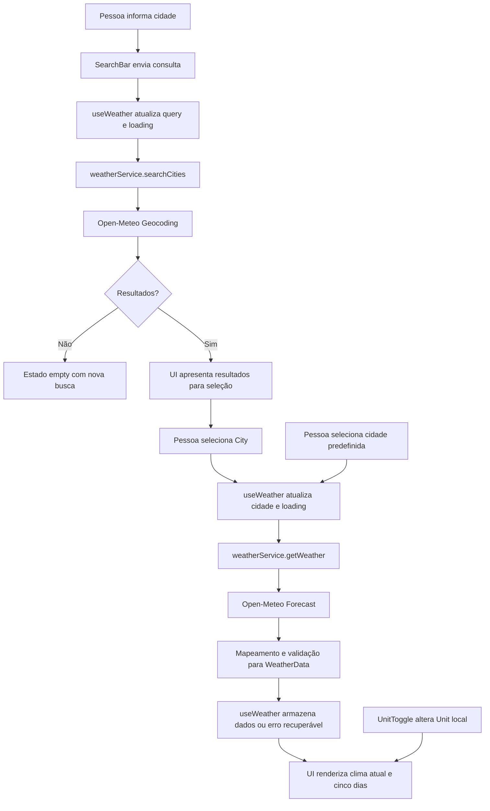

-  N --> O[UI renderiza clima atual, horários e cinco dias]

# Plano Técnico — Weather App

Este plano deriva da [especificação do produto](../specs/weather-app-spec.md) e orienta as tarefas de implementação. A spec é a fonte de verdade; a estrutura e os testes atuais foram consultados para manter as decisões compatíveis com o projeto existente.

## Architecture Overview

A aplicação é uma SPA em React. A camada de apresentação recebe estado e callbacks do hook `useWeather`; o hook orquestra busca, seleção, carregamento e retry; `weatherService` concentra HTTP, validação básica e mapeamento das respostas da Open-Meteo para tipos de domínio. Conversões de unidade e formatação permanecem na camada de apresentação/utilitários, sem nova chamada de rede.

Além dos resultados de geocoding, a composição da tela expõe atalhos locais para Curitiba, Maringá e Matinhos; esses botões entregam objetos `City` conhecidos a `selectCity`, sem executar geocoding.

O fluxo respeita a seleção explícita de cidade definida em RF1: resultados de geocoding são apresentados para desambiguação e a previsão só é solicitada após a pessoa escolher um resultado. O código atual já tem `cities` no hook, mas carrega automaticamente o primeiro resultado e a `SearchBar` não apresenta uma lista selecionável; esse é um gap entre a implementação atual e a spec, não uma mudança de requisito.

Referências: RF1–RF5; RNF de resiliência, acessibilidade e qualidade.

## Tech Stack

| Tecnologia | Uso e justificativa | Rastreabilidade |
| --- | --- | --- |
| TypeScript strict | Contratos explícitos entre serviço, hook e UI, incluindo campos opcionais/parciais. | RF1–RF5; RNF de qualidade e resiliência |
| React 19 | SPA com componentes e estado local; compatível com a implementação atual. | RF1–RF5 |
| Vite | Desenvolvimento e build estático para publicação sem servidor de aplicação. | RNF de performance e publicação |
| Tailwind CSS 3 | Estilo responsivo já adotado, mobile-first. | RNF de responsividade e acessibilidade |
| Open-Meteo Geocoding e Forecast | Busca de localidades e dados meteorológicos sem API key. | RF1–RF3; RNF de publicação |
| Vitest, Testing Library e jsdom | Testes unitários/componentes no ambiente já configurado. | RNF de qualidade |
| Playwright | Verificação dos fluxos completos e viewports mobile/desktop. | RF1–RF5; RNF de responsividade e acessibilidade |
| Biome | Lint e formatação dos arquivos de aplicação e teste. | RNF de qualidade |

## Project Structure

Manter a organização já existente, sem introduzir camadas ou estado global desnecessários:

| Caminho | Responsabilidade |
| --- | --- |
| `src/App.tsx` | Compor marca, atalhos de cidades, busca, seletor de unidade e os estados/telas de clima. |
| `src/components/` | UI de busca e seleção, clima atual, lista diária, unidade e estados de loading, erro e vazio. A seleção de resultado deve ser acessível por teclado; pode ser composta na estrutura atual. |
| `src/components/states/` | Apresentar estados de carregamento, erro recuperável e ausência de dados/resultados. |
| `src/hooks/useWeather.ts` | Manter estado da busca e coordenar chamadas do serviço, seleção de cidade e retry. |
| `src/services/weatherService.ts` | Consultar endpoints, tratar falhas HTTP/rede/timeout e mapear payloads externos para o domínio. |
| `src/types/weather.ts` | Tipos compartilhados de cidade, clima, previsão e unidade. |
| `src/lib/` | Conversão de temperatura, códigos meteorológicos e formatação localizada, como já adotado. |
| `tests/unit/` | Testes de serviço, utilitários e componentes/hook com Vitest e Testing Library. |
| `tests/e2e/` | Fluxos observáveis do produto com Playwright e APIs interceptadas. |

Referências: RF1–RF5; RNF de acessibilidade, idioma/localização e qualidade.

## Data Model

Contratos conceituais em TypeScript. Temperaturas são mantidas em Celsius; valores ausentes são representados por `null` para que a UI indique indisponibilidade sem ocultar os demais dados (RF2, RF3 e resiliência). As unidades de velocidade e pressão seguem os parâmetros/valores retornados pela API e devem ser identificadas corretamente na apresentação.

```ts
export type Unit = 'celsius' | 'fahrenheit';

export interface City {
  id: number;
  name: string;
  country: string;
  admin1?: string;
  latitude: number;
  longitude: number;
}

export interface CurrentWeather {
  time: string;
  temperature: number | null; // Celsius
  weatherCode: number | null;
  humidity: number | null;
  windSpeed: number | null;
  pressure: number | null;
  precipitation: number | null;
}

export interface ForecastDay {
  date: string;
  min: number | null; // Celsius
  max: number | null; // Celsius
  weatherCode: number | null;
  precipitationProbability: number | null;
  windSpeedMax: number | null;
}

export interface HourlyForecast {
  time: string; // hora local ISO YYYY-MM-DDTHH:mm
  temperature: number | null; // Celsius
  weatherCode: number | null;
  precipitationProbability: number | null;
  uvIndex: number | null;
}

export interface WeatherData {
  city: City;
  current: CurrentWeather;
  forecast: ForecastDay[]; // cinco dias consecutivos, hoje primeiro
  hourly: HourlyForecast[]; // horários disponíveis para a data local de hoje
}
```

`precipitationProbability` acompanha o campo de probabilidade usado pelo serviço e pela UI atuais. A spec pede “precipitação”, sem distinguir probabilidade de volume; confirmar essa semântica é uma decisão pendente de produto antes de tratar a probabilidade como definição final. `windSpeedMax` é necessário para RF3, mas ainda não existe no tipo nem no mapeamento atual.

Referências: RF1–RF4; RNF de resiliência e idioma/localização.

## Data Flow



A submissão vazia ou contendo apenas espaços não chama o serviço. A troca de `Unit` converte as temperaturas já carregadas e não atravessa o fluxo de rede. Erros de geocoding e forecast mantêm contexto suficiente para a ação de retry apropriada.

Referências: RF1–RF5; RNF de performance, resiliência e acessibilidade.

## External APIs

Usar HTTPS e `fetch` nativo, sem segredo no cliente. O serviço atual já aplica timeout via `AbortController`; manter tratamento equivalente para as duas operações.

**Geocoding** — `GET https://geocoding-api.open-meteo.com/v1/search`

Parâmetros: `name` (consulta com espaços/acentos codificados), `count` (limite de resultados; o código atual usa `5`), `language=pt` e `format=json`. Mapear `id`, `name`, `country`, `admin1`, `latitude` e `longitude`; `admin1` pode não existir.

Exemplo abreviado de resposta:

```json
{"results":[{"id":123,"name":"São Paulo","admin1":"São Paulo","country":"Brasil","latitude":-23.55,"longitude":-46.63}]}
```

**Forecast** — `GET https://api.open-meteo.com/v1/forecast`

Adicionar `hourly=temperature_2m,weather_code,precipitation_probability,uv_index`. Filtrar a série horária pela primeira data diária local para obter apenas as horas de hoje; preservar valores ausentes como `null`. A ausência da série horária não invalida current/daily e deve resultar no estado horário indisponível.

Parâmetros: `latitude`, `longitude`, `current=temperature_2m,relative_humidity_2m,wind_speed_10m,surface_pressure,precipitation,weather_code`, `daily=weather_code,temperature_2m_max,temperature_2m_min,precipitation_probability_max,wind_speed_10m_max`, `forecast_days=5`, `timezone=auto` e `temperature_unit=celsius`. `wind_speed_unit` pode ser fixado em `kmh` para manter explícita a unidade já exibida pela UI. `timezone=auto` permite alinhar o início dos cinco dias à data local consultada. Converter para Fahrenheit somente na apresentação.

Exemplo abreviado de resposta (as séries diárias contêm cinco posições):

```json
{
  "current": {"time":"2026-06-16T12:00","temperature_2m":18,"relative_humidity_2m":80,"wind_speed_10m":10,"surface_pressure":1015,"precipitation":0,"weather_code":3},
  "daily": {
    "time":["2026-06-16","2026-06-17","2026-06-18","2026-06-19","2026-06-20"],
    "weather_code":[3,61,80,1,0],
    "temperature_2m_max":[20,19,22,24,25],
    "temperature_2m_min":[12,11,13,14,15],
    "precipitation_probability_max":[20,90,70,10,0],
    "wind_speed_10m_max":[18,22,14,12,16]
  }
}
```

Validar status HTTP e a estrutura da resposta antes do mapeamento. Campos ausentes individuais devem resultar em valores indisponíveis, não em falha de toda a tela; payload incompatível ou ausência da estrutura essencial deve gerar erro recuperável. O código atual já consulta `current`, `daily`, `forecast_days=5` e `timezone=auto`, mas não solicita vento máximo diário e trata a ausência dos objetos `current`/`daily` como erro.

Referências: RF1–RF3, RF5; RNF de resiliência e publicação.

## State Management

Manter o estado do domínio de busca em `useWeather`, conforme o padrão atual, sem biblioteca externa. Estado conceitual: `status` (`idle | loading | success | error | empty`), `query`, `cities`, `selectedCity`, `data` e `error`. Separar a lista de resultados da cidade selecionada: resultados não implicam seleção e não disparam forecast até uma escolha explícita (RF1). `retry` repete geocoding quando a busca falhou ou forecast para a cidade escolhida.

Os atalhos usam uma lista constante de `City` com coordenadas fixas para Curitiba (-25.4284, -49.2733), Maringá (-23.4205, -51.9333) e Matinhos (-25.8176, -48.5428); selecionar um atalho chama `selectCity` diretamente.
Derivar a recomendação das três primeiras horas ainda futuras (comparadas lexicograficamente na timezone local). Aplicar a ordem: chuva com probabilidade ≥50%, UV ≥6, temperatura ≤10 °C; sem condição, exibir a mensagem neutra. A recomendação não é estado persistido nem substitui os dados por hora.

Manter `Unit` como estado local da composição da UI, inicialmente Celsius, e derivar todos os valores apresentados a partir dos dados Celsius existentes. Isso cobre alternância inclusive durante carregamento, sem nova requisição (RF4). Não persistir cidade, unidade ou histórico; persistência está fora do escopo da v1.

Referências: RF1, RF4, RF5; RNF de simplicidade e qualidade.
Referências: RF1, RF4, RF5, RF7; RNF de simplicidade e qualidade.

## Error Handling Strategy

| Situação | Comportamento esperado | Requisito |
| --- | --- | --- |
| Inicial sem cidade/dados | Mostrar orientação de busca, sem clima fictício. | RF5 |
| Consulta vazia/espaços | Não requisitar; manter estado inicial ou a tela não comprometida. | RF1, RF5; edge case da spec |
| Geocoding sem resultados | Mostrar estado vazio, permitir nova consulta. | RF1, RF5 |
| Geocoding indisponível, erro HTTP ou timeout | Mensagem compreensível e retry da busca. | RF5; RNF de resiliência |
| Forecast indisponível, erro HTTP ou timeout | Manter a cidade identificada e permitir retry para essa cidade. | RF5; RNF de resiliência |
| Campo individual ausente/nulo | Mostrar marcador neutro somente para esse dado e preservar o restante. | RF2, RF3; RNF de resiliência |
| Resposta sem estrutura essencial ou incompatível | Não renderizar dados inválidos; apresentar erro recuperável. | RF5; RNF de resiliência |
| Requisição em andamento | Indicar loading e evitar que interações concorrentes deixem estado inconsistente. | RF5; RNF de performance |

Tratar falhas em uma fronteira comum do service/hook e exibir mensagens em pt-BR. O retry deve repetir a operação que falhou, sem exigir redigitação quando a cidade já foi selecionada. A interface deve preservar foco visível e nomes acessíveis nos controles e ações (RNF de acessibilidade).

## Testing Strategy

Usar `pnpm test` (Vitest) para unitários e componentes, `pnpm test:e2e` (Playwright) para jornadas. A infraestrutura existente usa Testing Library, `user-event`, jsdom e interceptação de APIs no Playwright.

**Vitest e Testing Library:**

- `weatherService`: construir URLs/parâmetros, codificar consultas, mapear resultados e payload completo, tratar sem resultados, HTTP/rede/timeout e campos parciais, incluindo vento máximo diário.
- `temperature` e formatadores: conversões determinísticas C/F, formatação pt-BR e valores ausentes.
- `useWeather`/`App` e componentes: estado inicial, loading, vazio e erro; vários resultados sem auto-seleção; seleção explícita; retry da busca e do forecast; alternância de unidade sem nova chamada de rede; acessibilidade básica por role/label e teclado.
- `App`: marca “Qual é o tempo?”; cada atalho seleciona a cidade correta e chama forecast sem geocoding.
- `HourlyForecast`: valida seleção do dia local, tabela acessível, métricas parciais e limite de horas.
- `weatherSuggestion`: testa os limiares e a prioridade entre chuva, UV, frio e fallback neutro.

**Playwright:**

- Fluxo de busca com resultados desambiguados, seleção explícita, clima atual e cinco dias (RF1–RF3).
- Alternância C/F para temperatura atual e mínima/máxima sem nova requisição (RF4).
- Nenhum resultado, falha de geocoding, falha de forecast e retry (RF5).
- Consulta vazia e resultados parciais sem quebra da tela.
- Seleção de cada cidade predefinida, sem uma requisição de geocoding adicional.
- Previsão por hora para a data local, recomendação adequada aos próximos dados e ausência de alerta.
- Layout e operação dos controles em 320 px e em viewport desktop, sem rolagem horizontal; navegação por teclado e foco visível.

Interceptar as APIs nos E2E para resultados determinísticos, como os testes atuais já fazem; cobrir falhas e datasets parciais por fixtures. Executar os gates do projeto: `pnpm lint`, `pnpm build` e `pnpm test`; `pnpm test:e2e` complementa a validação de jornada.

Rastreabilidade: RF1–RF7; RNF de responsividade, acessibilidade, localização e qualidade.

## Risks & Trade-offs

| Risco/decisão | Impacto | Mitigação ou trade-off | Referências |
| --- | --- | --- | --- |
| Resultados homônimos podem carregar o local errado se houver seleção automática. | Dados de outra cidade e violação de RF1. O código atual escolhe o primeiro resultado. | Exigir escolha explícita e exibir nome, região disponível e país. | RF1; RNF de acessibilidade |
| A API ou a rede podem falhar ou exceder o timeout. | Busca/previsão indisponível. | Timeout, mensagens claras, estado não bloqueante e retry da operação apropriada. | RF5; RNF de resiliência |
| Respostas parciais podem conter campos faltantes ou séries inconsistentes. | Erro de renderização ou informação incompleta. | Tipar campos individuais como indisponíveis, validar dados e testar fixtures parciais; conservar dados válidos. | RF2, RF3; RNF de resiliência |
| A previsão atual não solicita `wind_speed_10m_max`. | Não atende a velocidade máxima diária de RF3. | Incluir o campo no contrato do endpoint e no mapeamento; cobrir com teste. | RF3 |
| “Precipitação” não especifica se é chance ou volume. | A apresentação pode não corresponder à expectativa. | A UI atual apresenta probabilidade máxima (%); confirmar essa interpretação, sem adicionar uma métrica fora do escopo. | RF2, RF3 |
| Unidade incorreta ou conversão repetida pode distorcer valores. | Leitura meteorológica errada. | Preservar Celsius como base e converter apenas na apresentação; testar ambos os sentidos. | RF4; risco da spec |
| Data e início da previsão dependem do fuso da cidade. | “Hoje” pode divergir do fuso local. | Solicitar `timezone=auto` e validar cinco dias consecutivos a partir da data local. | RF3; RNF de localização |
| Serviço público externo é sujeito a indisponibilidade/limites. | Busca ou forecast temporariamente indisponível. | Sem chave no cliente; tratar erros e retry. Cache, backend proxy e modo offline não entram na v1. | RF5; RNF de publicação; fora de escopo |
| Viewport estreito ou controles inacessíveis. | Jornada prejudicada em mobile ou por teclado. | Mobile-first, sem rolagem horizontal, semântica, labels e foco visível; validar 320 px e desktop. | RNF de responsividade e acessibilidade |

## Rastreabilidade

| Requisito | Decisões e validação no plano |
| --- | --- |
| RF1 | Geocoding, lista de resultados e seleção explícita; teste unitário e jornada E2E com cidades ambíguas. |
| RF2 | `CurrentWeather`, renderização de campos disponíveis e marcador para ausência; serviço e UI testados. |
| RF3 | `ForecastDay`, cinco datas locais consecutivas, temperaturas, condição, precipitação e vento máximo diário; fixtures de cinco dias. |
| RF4 | Unidade local e Celsius como valor de domínio; conversão C/F sem nova chamada, coberta em unitário e E2E. |
| RF5 | Estados inicial/loading/empty/error, mensagens compreensíveis e retry específico; cenários unitários e E2E. |
| RF6 | Atalhos de cidade alimentam `selectCity` diretamente, sem geocoding. |
| RF7 | Série horária local em tabela acessível e recomendação por regra; testes de serviço, limiares e E2E. |
| RNF — Performance | Feedback durante rede; SPA estática com Vite. |
| RNF — Responsividade | Mobile-first, teste em 320 px e desktop, sem rolagem horizontal. |
| RNF — Acessibilidade | Semântica, labels, operação por teclado e foco visível nos controles. |
| RNF — Resiliência | Timeout, validação, dados parciais e retry sem travar a interface. |
| RNF — Publicação | Vite gera aplicação estática; Open-Meteo sem chave ou segredo no cliente. |
| RNF — Idioma/localização | Textos pt-BR, formatação local e timezone da cidade para as datas. |
| RNF — Qualidade | Lint, build, unitários e E2E executáveis pelos scripts existentes. |